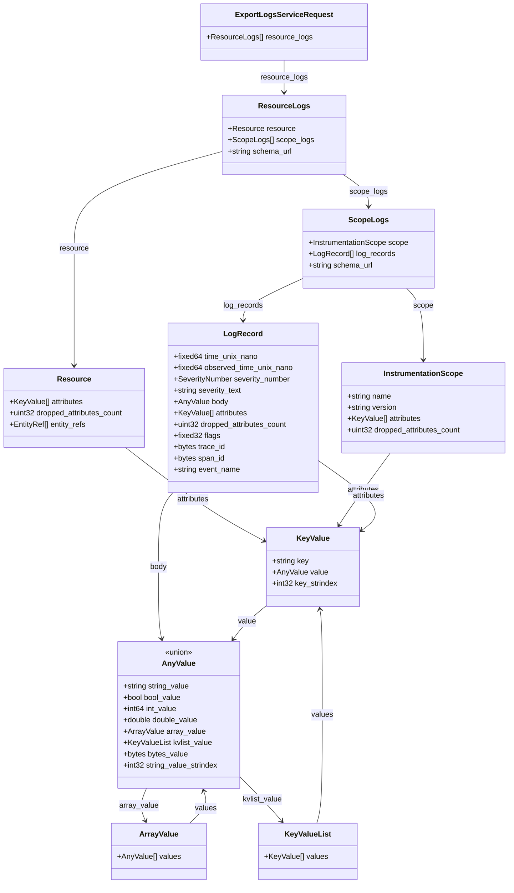
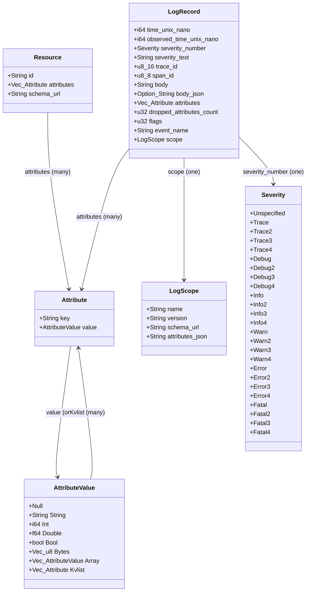
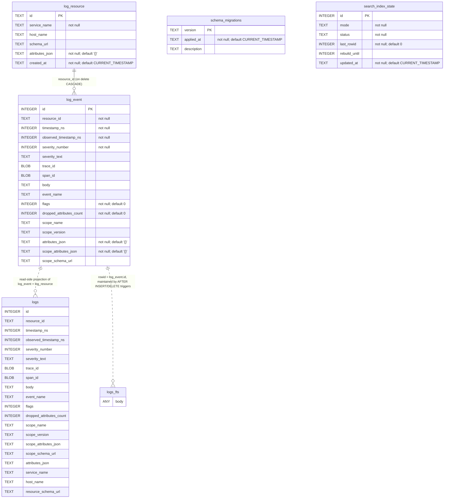
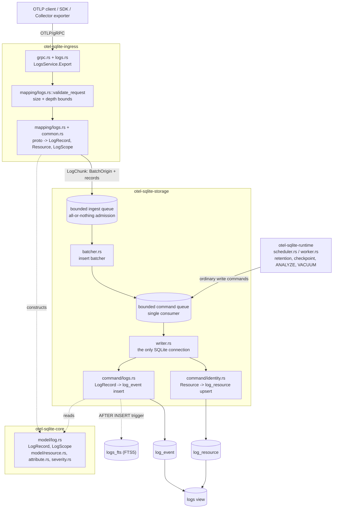

<!-- GENERATED FILE - do not edit by hand. -->
# Data models, rendered

Embedded copies of the `.mmd` sources next to this file, because GitHub
renders `mermaid` fences but not `.mmd` files. The sources are authoritative:
edit and regenerate those, never the fences below.

```text
UPDATE_MODEL_DOCS=1 cargo test -p otel-sqlite-storage --test model_traceability
```

## Wire model: how an OTLP logs export nests

Source: [`wire.mmd`](wire.mmd)



## Domain model: the in-memory types and the module owning each

Source: [`domain.mmd`](domain.mmd)



## Persisted schema: the current schema only, generated from a migrated database

Source: [`schema.mmd`](schema.mmd)



## Conversion path: which module turns a message into a row

Source: [`pipeline.mmd`](pipeline.mmd)


