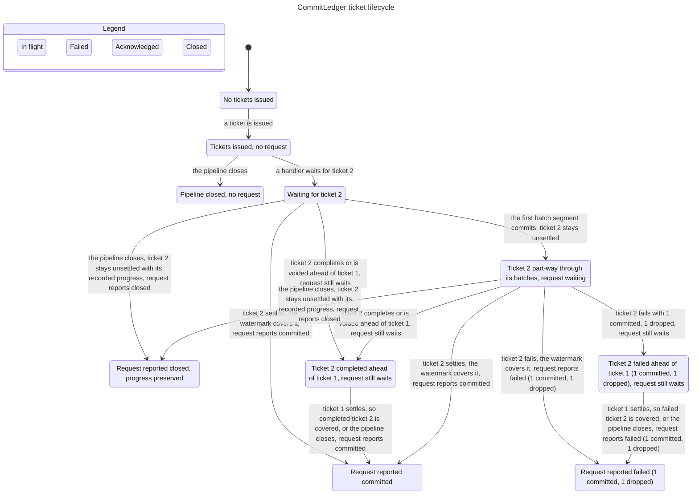

# CommitLedger ticket lifecycle

`CommitLedger` (`crates/otel-sqlite-core/src/storage/commit.rs`) is the
durability-ticket registry behind `durability = "commit"`. Ingress issues a
ticket for each accepted chunk; the writer records durable progress for every
batch segment with `note_committed`, records quarantined records with
`note_dropped`, and calls `complete` only when the ticket's last record has
committed. A chunk split across batches therefore stays
`Unsettled { progress }` until its final segment. A ticket with quarantined
records settles `Failed { committed, dropped }`; a clean one settles
`Completed`; a rejected enqueue or empty chunk voids its ticket. The contiguous
watermark advances over completed, voided, and failed tickets alike. The
ingress handler waits with `wait_watermark(ticket)`, which does not report until
every lower ticket is settled (or the pipeline closes), then reads each
ticket's state to build the partial-success response. `wait(ticket)` resolves
on the ticket's own state: `Committed`, `Failed`, or `Closed`; the
`committed()` wrapper keeps its old `Ok`/`Err` shape and collapses `Failed`
and `Closed` to `Err`. `close()` keeps
the recorded progress and failure state and resolves an unsettled ticket as
`Closed`; completed or failed evidence still wins. The model uses three
tickets and one request for ticket 2: ticket 1 is the gap below it, ticket 3
can settle ahead, and ticket 2 gets a partial first segment and may be
quarantined. It also models duplicate settlement, void, and close. It mirrors
the ledger calls, not SQLite, batching, or the watch channel's scheduling.

## Chart



TLC reached **176 states and 541 steps**. The chart draws **10 states and 14
arrows**. The view hides 381 steps that stay in one chart state: additional
ticket issuance, a close before any ticket is issued, duplicate settlement,
quarantine progress before the final segment, settlements of the other tickets
that do not change the focused request, ledger or close changes after the
request has already reported, and the idle `Done` stutter. The exact chart
text is also stored as `docs/statecharts/core.mmd`.

## Rules checked

Each row is a rule TLC checks; all except `NoDeadlock` are invariants in
`CommitLedger.cfg`. The reader's sentence is the rule the chart is meant to
make obvious.

| Rule | Reader's sentence | Result |
| --- | --- | --- |
| `WatermarkContiguous` | `committed_through = N` means every ticket ≤ N is completed, voided, or failed; the watermark is the largest settled prefix and never skips an unsettled ticket. | Holds |
| `ParkedTicketsAreExactlySettledAbove` | Settled tickets above the watermark wait for the missing predecessor; the parked set is exactly the settled tickets above the watermark. | Holds |
| `FailedAdvancesLikeCompleted` | A failed ticket advances the contiguous watermark exactly like a completed ticket once every lower ticket is settled. | Holds |
| `VoidedAdvancesLikeCompleted` | A voided ticket advances the watermark exactly like a completed ticket. | Holds |
| `RequestWaitsForWatermark` | The ingress request is not released while the watermark is below its ticket; a later ticket failing out of order does not release it. | Holds |
| `RequestReportedAfterCoverageOrClose` | The request reports only after the watermark covers its ticket or the pipeline closes. | Holds |
| `RequestOutcomeMatchesTicketState` | The request reports Committed for a completed or voided ticket, Failed for a quarantined ticket with its committed/dropped counts, and Closed only for an unsettled ticket at close. | Holds |
| `TicketWaitMatchesState` | The compatibility `wait` resolves on the ticket's own state: completed or voided → Committed, failed → Failed, unsettled at close → Closed, unsettled and open → still waiting, even when the ticket settled out of order; `committed` maps Failed and Closed to `Err`. | Holds |
| `ProgressWithinRecords` | The focused ticket never records more committed plus dropped records than it has. | Holds |
| `FailedTicketsHaveDroppedRecords` | A ticket settles Failed only when at least one of its records was quarantined. | Holds |
| `SuccessfulTicketsDropProgress` | A completed or voided ticket exposes no remaining progress. | Holds |
| `ClosePreservesProgress` | `close()` leaves the request ticket's state and committed/dropped counts in place. | Holds |
| `CloseOutcomeMatchesTicketState` | `close()` reports Committed for completed or voided evidence, Failed for failed evidence, and Closed only when the ticket is still unsettled. | Holds |
| `DuplicateSettlementIsIdempotent` | Settling an already settled ticket again leaves the watermark, the parked set, and the outstanding count unchanged. | Holds |
| `OutstandingCount` | `outstanding_tickets` counts exactly the issued tickets that are not settled, including tickets with partial progress. | Holds |
| `TypeOK` | Every reachable state has well-formed ticket, progress, watermark, and request fields. | Holds |
| `NoDeadlock` | Every reachable state has a step; a closed idle state stutters via `Done`. | Holds |

No rule breaks; all 17 checks pass.

The request arrow is the ingress `wait_watermark` path, not `wait(ticket)`. A
direct `wait(2)` would return `Failed` or `Committed` as soon as ticket 2
settles ahead of ticket 1; `TicketWaitMatchesState` records that mapping. The
`committed()`
compatibility wrapper collapses both `Failed` and `Closed` to
`Err(CommitLedgerClosed)`, so only `wait` exposes the three outcomes. The
ingress request stays in "Ticket 2 failed ahead..., request still waits" so it
can wait for ticket 1 and report the truthful partial result. `Request reported failed`
means the ledger outcome `CommitOutcome::Failed`, not necessarily a retryable
RPC failure: ingress reports the committed records and returns
`partial_success` for the dropped ones. `Request reported closed` likewise
preserves any committed progress; ingress reports it as partial success when
some records are durable, otherwise `UNAVAILABLE`.

The failed ticket and a completed ticket both advance the contiguous watermark
once ticket 1 settles: `s8 -> s9` and `s5 -> s7`. A ticket still part-way
through its batches (`s6`) remains unsettled, so the request is not released
until the final segment settles or the pipeline closes. Close keeps the
counts: `s3 -> s4` and `s6 -> s4` report Closed, while `s5 -> s7` and
`s8 -> s9` report the completed or failed evidence even when close caused the
last transition. Close from `s6` preserves the recorded progress: the focused
case keeps 1 committed (and 1 dropped if quarantine had already run), even
though the request reports Closed.

## Bug paths

None. The final report has no `## ... breaks` sections and every rule is under
"Rules that hold". No replay against a bug path was needed. The commit-ledger
unit tests pass: `cargo test -p otel-sqlite-core storage::commit` runs 19 tests,
including partial progress, quarantined tickets, close preserving progress,
`wait_watermark` across a failed later ticket, and failed tickets staying
failed after later commits.

## What the model intentionally leaves out

- **The storage pipeline.** Batching, the SQLite transaction, the writer's
  segment construction, salvage and quarantine, fault injection, health
  sampling, and `last_advance_ms` are outside the chart. The ledger only sees
  `note_committed`, `note_dropped`, `complete`, `void`, and `close`.
- **More than one request and the ticket-zero sentinel.** The model has one
  ingress request waiting for ticket 2. Ticket 0 (`wait(0)` resolves
  `Committed`) and several concurrent requests are not represented.
- **A request that starts after partial progress or after settlement.** The
  chart starts the waiter before the first segment and follows ticket 2 from
  there; a request that starts later sees the same ticket state, but that
  ordering is not charted. A ticket 2 that settles before the handler waits is
  likewise not charted. Issuing or voiding tickets after close is also not
  modeled.
- **Record counts beyond the focused scenario.** The model gives ticket 2 two
  records: one committed segment and, optionally, one quarantined record.
  Arbitrary record counts and multiple split segments are not enumerated.
- **Duplicate settlement and intermediate progress as visible arrows.**
  Repeated settlement is a no-op; `note_dropped` before `complete` changes
  only the recorded count. Both stay in one chart state and are hidden.
- **The other tickets' full lifecycles.** Ticket 1 is the gap and ticket 3 can
  park ahead; their settlements are hidden unless they change the focused
  request's state.
- **Concurrent publication order.** Each `issue`, `note_*`, `complete`,
  `void`, `close`, `wait`, and `wait_watermark` call is one atomic step. The
  model does not explore the order in which the `watch` channel publishes a
  settlement and a close from different threads; it charts the ledger's
  logical lifecycle, not thread-safety.
- **The rest of the durability vocabulary.** `DurabilityMode::Enqueue`,
  `SyncMode`, all-or-nothing admission, and per-origin ticket folding are not
  part of the ticket lifecycle chart.

## Reproduce

The spec, config, view, and checked run are in
`/tmp/opencode/statechart-core` (`CommitLedger.tla`, `CommitLedger.cfg`,
`view.ts`, `run-v2-h/`). Use a new `--out` folder:

```sh
cd /tmp/opencode/statechart-core
TLA2TOOLS=/tmp/opencode/tla2tools.jar JAVA=/usr/bin/java \
  node /home/nnadolski/projects/otel-sqlite/.agents/skills/statechart/scripts/statechart.ts \
  CommitLedger.tla --config CommitLedger.cfg --view view.ts \
  --out run-v2-reproduce
```

`run-v2-reproduce` must not exist or must be empty. The checked run is
`run-v2-h/`; the command reproduces the same 176-state, 541-step result when
given a fresh folder.
