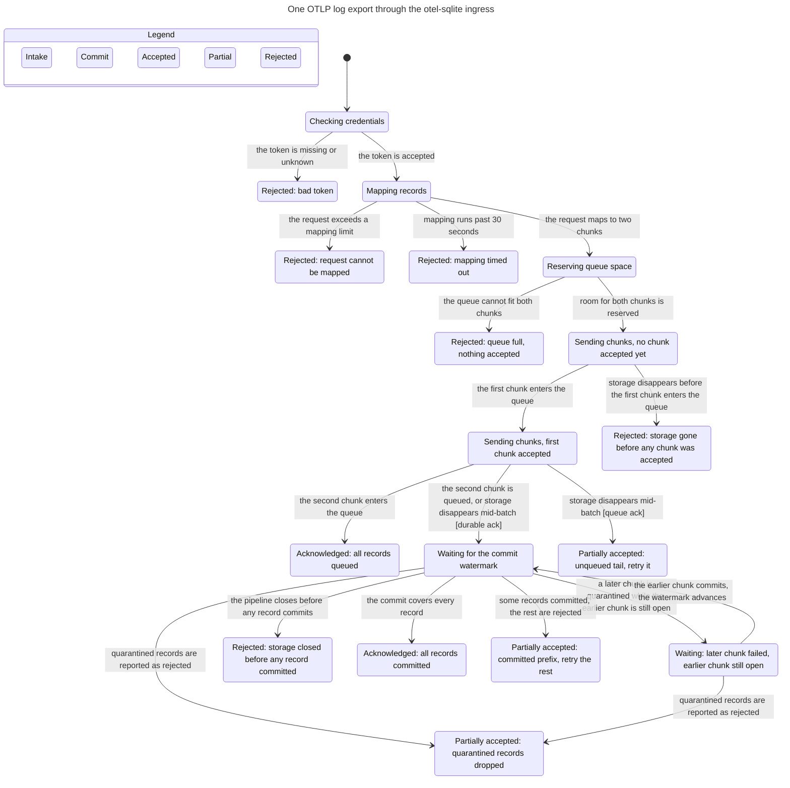

# Ingress: one OTLP log export and its response

This statechart models one OTLP log export through the ingress in both
`durability = "commit"` and `durability = "enqueue"` modes: credentials are
checked, the request is mapped, room for the whole request is reserved on the
bounded ingest queue, each chunk is sent, and the handler turns the enqueue
outcome into the wire response. It follows `LogsIngress::finish`, the enqueue
outcome in `crates/otel-sqlite-ingress/src/{logs,enqueue}.rs`, the commit
ledger in `crates/otel-sqlite-core/src/storage/commit.rs`, and the writer's
quarantine settlement in `crates/otel-sqlite-storage/src/writer.rs`.

In commit mode the handler waits for the contiguous watermark covering the
highest accepted ticket, then inspects every accepted ticket. Records behind
completed tickets, and the committed part of an unsettled or failed ticket,
count as committed; `rejected_log_records` is the request total minus that
count. A partly accepted request returns `partial_success` when some records
committed **or** a ticket was quarantined, even if nothing committed. A
retryable `UNAVAILABLE` is reserved for requests with no durable records at
all. In enqueue mode the handler acknowledges at queue entry and reports only
the unqueued tail as partial success.

The model uses two chunks, one record per chunk, and a two-slot queue. It
follows one request, not concurrent exporters. The storage pipeline appears
only as queue capacity, ticket settlement, and a pipeline that can close.

## Chart

TLC reached **113 states and 177 steps**. The chart draws **18 states and 19
arrows**. The view hides 95 steps that do not change the chart state: pipeline
death, most ticket commits and quarantines while sending, settlements that
leave a label unchanged, and the final stutter. The exact chart text is also
stored as `docs/statecharts/ingress.mmd`.

The separate waiting state is the out-of-order case: a later chunk is
quarantined while an earlier chunk is still open. The response cannot leave
that state until the earlier ticket settles (or the pipeline closes), which is
what `OutOfOrderFailureWaitsForWatermark` checks. A quarantine with nothing
committed still ends in partial success, because retrying the dropped records
cannot help.

## Rules checked

| Rule | Reader's sentence | Result |
| --- | --- | --- |
| `RetryableOnlyWithoutDurableRecords` | A retryable `UNAVAILABLE` response implies no record of the request is durable. | Holds |
| `PlainSuccessMeansAllAcceptedCommitted` | A commit-mode 2xx without `partial_success` means every accepted record committed. | Holds |
| `PartialSuccessReportsRejected` | A commit-mode 2xx with `partial_success` reports `rejected_log_records = total - committed`, including quarantined and never-accepted records. | Holds |
| `NoRetryOfCommittedRecords` | The handler never returns a retryable failure when any accepted record is committed. | Holds |
| `OutOfOrderFailureWaitsForWatermark` | A later failed ticket does not release the response while an earlier accepted ticket is unsettled; only a closed pipeline permits that early answer. | Holds |
| `QueueFullAcceptsNothing` | A queue-full rejection issues no ticket and accepts nothing. | Holds |
| `EnqueuePartialReportsUnqueuedTail` | In enqueue mode, a partial success reports exactly the unqueued tail and never asks for the queued prefix again. | Holds |
| `NoDeadlock` | Every reachable state has a step; end states stutter via `Done`. | Holds |

## Bug paths

None. TLC explored every reachable state and found no violation of any rule,
so there is no shortest path to a break.

The notable paths all end in an honest response:

- A mid-batch disconnect after the first chunk committed reaches
  **“Partially accepted: committed prefix, retry the rest”**; the committed
  chunk is not retried.
- A quarantine with zero commits reaches **“Partially accepted: quarantined
  records dropped”**, including records that were never accepted.
- A later failed ticket with an earlier open ticket enters **“Waiting: later
  chunk failed, earlier chunk still open”**; it leaves through the earlier
  chunk's settlement, not its own failure.
- A closed pipeline with no commit and no quarantine reaches **“Rejected:
  storage closed before any record committed”**, the only storage-side
  retryable outcome.
- An enqueue-mode disconnect after the first chunk was queued reaches
  **“Partially accepted: unqueued tail, retry it”** and leaves the queued
  prefix alone.

## What the model intentionally leaves out

- Authentication is an accept/reject branch; token-file reload, rotation, and
  revocation are omitted.
- Mapping validation is collapsed to one rejection; the mapping timeout's
  background task is not modeled.
- Each chunk carries one record, and a ticket is only open, completed, or
  failed. Split-chunk progress (`note_committed` on a partially written
  ticket) is abstracted away; the `total - committed` arithmetic is still
  checked for quarantined and never-accepted records.
- Ticket voiding for the failed send is not modeled; it does not affect
  accepted records.
- The model uses two chunks and two queue slots, so the permanent “request
  maps to more chunks than capacity” `INVALID_ARGUMENT` path is not
  reachable.
- Queue drain, concurrent exporters, the process-wide stream limit, TLS/mTLS,
  health status, and the shutdown drain deadline are omitted.
- Enqueue-mode commits after the acknowledgement are not modeled; the
  response has already been sent. Commits during sending are modeled so the
  durable-ack rules can be checked.
