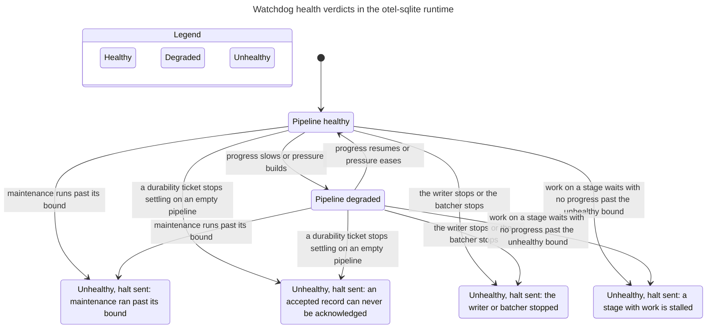

# Runtime watchdog health verdicts

This statechart models the `otel-sqlite-runtime` watchdog's health-verdict
machine. The watchdog samples writer and batcher liveness, progress ages,
pending work (queued commands, buffered records, and chunks still in the
ingress channel), command-queue pressure, durability-ticket progress, and the
maintenance window, then derives `Healthy`, `Degraded`, or `Unhealthy`; an
unhealthy verdict sends the one-shot halt that stops OTLP ingestion. A stage's
progress age is judged only while that stage has work: the writer when a
command is queued or executing, the batcher when a record is buffered or a
chunk is waiting in its ingress channel. The model mirrors `evaluate()` and the
one-shot halt branch of `run()` in
`crates/otel-sqlite-runtime/src/watchdog.rs` and treats each arrow as one
watchdog sample. It does not model the storage pipeline, the maintenance
scheduler or worker, or process restart; those are outside this chart.

## Chart

TLC reached **434 states and 103,921 steps**. The chart draws **6 states and
10 arrows**. The remaining 28,780 steps stay in one chart state and are not
drawn.

## Rules checked

Each row is a rule TLC checks; all except `NoDeadlock` are invariants in
`RuntimeWatchdog.cfg`. The reader's sentence is the rule the chart is meant to
make obvious.

| Rule | Reader's sentence | Result |
| --- | --- | --- |
| `VerdictMatchesEvidence` | The recorded verdict is exactly what the evaluator derives from the sampled evidence. | Holds |
| `DeadWriterUnhealthy` | A stopped writer is `Unhealthy`. | Holds |
| `DeadBatcherUnhealthy` | A stopped batcher is `Unhealthy`. | Holds |
| `IdleHealthy` | An idle pipeline outside maintenance, with both threads running, zero pending work (including the ingress channel), and no leaked durability ticket whose stages have both been idle past the ack window, is `Healthy`, even when progress is old. | Holds |
| `StalledPendingUnhealthy` | Outside maintenance, pending work whose stage-with-work progress is at or past the unhealthy bound is `Unhealthy`; an idle stage's stale age does not count. | Holds |
| `StallOnlyFromStageWithWork` | A stall verdict can only come from a stage that actually has work; an idle stage's stale progress age is not evidence. | Holds |
| `SlowOrPressureDegraded` | Outside maintenance, with both threads running, pending work with slow progress on a working stage or queue pressure is `Degraded`, never `Healthy`. | Holds |
| `MaintenanceOverrunUnhealthy` | A maintenance command at or past its own bound is `Unhealthy`. | Holds |
| `MaintenancePressureDegraded` | During maintenance below its overrun bound, with both threads running, a frozen durability ticket or queue pressure is `Degraded`, never `Unhealthy`. | Holds |
| `MaintenanceHealthy` | During maintenance below its overrun bound, with both threads running, slow progress and pending work alone stay `Healthy`; the ordinary stall rules are suspended. | Holds |
| `LostTicketUnhealthy` | Outside maintenance, with both threads running, an outstanding durability ticket on an otherwise empty pipeline whose stages have both been idle past the ack window, with a frozen commit watermark, is `Unhealthy`; the records can never be acknowledged. | Holds |
| `TicketsWithWorkHealthy` | Outside maintenance, outstanding tickets behind visible work with fresh progress and a queue below pressure stay `Healthy`; they are indistinguishable from legitimate in-flight records. | Holds |
| `HealthyNoHalt` | A `Healthy` verdict never sends the halt. | Holds |
| `DegradedNoHalt` | A `Degraded` verdict never sends the halt. | Holds |
| `UnhealthyHaltsOnce` | With the default `halt_on_unhealthy = true`, an `Unhealthy` verdict sends the halt exactly once and stops observation. | Holds |
| `HaltOnlyForUnhealthy` | The halt signal only follows an `Unhealthy` verdict. | Holds |
| `EveryUnhealthyHasCause` | Every `Unhealthy` verdict has one of the chart's four causes. | Holds |
| `NoCauseWhenFine` | `Healthy` and `Degraded` verdicts carry no fatal cause. | Holds |
| `WatchdogNeverRestarts` | The watchdog never restarts a component; its only output is the halt. | Holds |
| `NoDeadlock` | The model has no reachable dead end; the stopped watchdog has a stuttering `Done` step. | Holds |

No rule breaks. The runtime crate's `cargo test -p otel-sqlite-runtime --lib`
passes, including the watchdog tests that exercise these cases.

### Precedence refinements

These short rules depend on the code's documented precedence:

- **Outside maintenance, idle is checked after the durability leak check.**
  The code checks `outstanding_tickets > 0 && pending == 0`, both stage ages
  at or past `ack_stall_after`, and `watermark_idle >= ack_stall_after` before
  the `pending == 0` idle shortcut. The two stage ages matter because a
  request that just entered the pipeline after a long idle period has a stale
  watermark age but fresh stage progress; it must not look like a leaked
  ticket. `LostTicketUnhealthy` records that exception; `IdleHealthy` applies
  when no stale ticket is outstanding.
- **A stage's age is judged only while it has work.** After a burst, the
  batcher can be blocked in `recv` with a stale progress age while the writer
  drains the command queue; that is healthy. The model therefore gates the
  writer age on queue depth and the batcher age on buffered/ingress work, and
  `StallOnlyFromStageWithWork` records the rule.
- **Maintenance suspends the ordinary stall rules.** While a maintenance
  command runs, the writer legitimately stops committing, so slow progress and
  pending work alone are `Healthy`. Queue pressure or a frozen durability
  ticket during maintenance is `Degraded`; only a maintenance command past
  `maintenance_stall_after` is `Unhealthy`. `MaintenanceHealthy`,
  `MaintenancePressureDegraded`, and `MaintenanceOverrunUnhealthy` record that
  precedence.

## Bug paths

None. The report lists every rule under "Rules that hold":

`VerdictMatchesEvidence`, `DeadWriterUnhealthy`, `DeadBatcherUnhealthy`,
`IdleHealthy`, `StalledPendingUnhealthy`, `StallOnlyFromStageWithWork`,
`SlowOrPressureDegraded`, `MaintenanceOverrunUnhealthy`,
`MaintenancePressureDegraded`, `MaintenanceHealthy`, `LostTicketUnhealthy`,
`TicketsWithWorkHealthy`, `HealthyNoHalt`, `DegradedNoHalt`,
`UnhealthyHaltsOnce`, `HaltOnlyForUnhealthy`, `EveryUnhealthyHasCause`,
`NoCauseWhenFine`, `WatchdogNeverRestarts`, `NoDeadlock`.

## What the model intentionally leaves out

- **Maintenance scheduler and worker.** `scheduler.rs` and `worker.rs` are not
  modeled. Maintenance appears only as watchdog evidence (`none`, `running`,
  `overrun`); how commands are scheduled, retried, or enqueued is out of scope.
- **The storage pipeline itself.** Writer/batcher behavior, the insert
  batcher, the command queue producer, SQLite, and the commit ledger are
  evidence sources, not modeled components. Arrows are watchdog samples; they
  do not simulate the pipeline's causal sequence.
- **Exact time.** Progress ages are representative values (fresh, at the
  degraded bound, at the unhealthy bound); watermark age is fresh or at the
  ack bound; maintenance is below or at/over its bound. The sampling tick and
  millisecond arithmetic are abstracted.
- **Queue depths above the pressure mark.** With capacity 3 and ratio 2/3 the
  threshold is 2; depths 2 and 3 produce the same verdict, so the model samples
  0 through the threshold. This keeps the reachable-state count under the
  chart budget.
- **Ingress-channel depth beyond zero versus non-zero.** The model folds a
  chunk waiting in the ingress channel into the batcher's "has work" flag; the
  verdict machine only cares whether the batcher has anything to consume, not
  the exact channel depth.
- **Dead-thread evidence.** A dead writer or batcher is represented by one
  canonical sample per thread; the evaluator's dead-thread check is first and
  is independent of the other evidence.
- **Non-default halting and edge cases.** `halt_on_unhealthy = false`, a halt
  receiver that has gone away (the code treats that as no halt), operator
  shutdown and drain ordering, and external process restart are not modeled.
- **Observability plumbing.** Metrics, logs, the gRPC serving check (which
  only checks that both threads are running), and the healthcheck subcommand
  are not part of the verdict machine.
- **Clean shutdown.** The chart ends at the one-shot halt. The normal
  operator-driven stop of the watchdog after ingress returns, the thread
  spawn/stop/join lifecycle, and the final health-gauge reset are not drawn.
