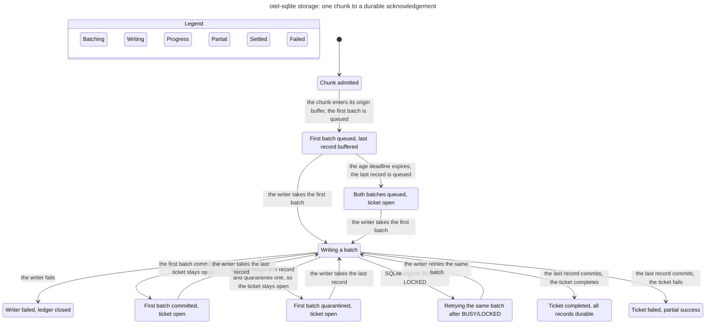

# Storage pipeline: one chunk to a durable acknowledgement

This statechart models one accepted log chunk through the current storage side
of `durability = "commit"`: the per-origin insert buffer, the first full batch
and the age-deadline remainder, the bounded command queue, the single SQLite
writer transaction, and the resulting commit, retry, quarantine, or fatal
outcome. It also models the commit-ticket state, because the ingress can only
distinguish a clean acknowledgement from a partial success by asking the
ledger. The model follows
`crates/otel-sqlite-storage/src/{batcher,origin_buffers,writer,transaction_group,error}.rs`,
`crates/otel-sqlite-core/src/storage/{batcher,commit,command}.rs`, and the
ingress `finish` path in `crates/otel-sqlite-ingress/src/logs.rs`. One chunk of
three records with batch capacity two becomes two storage batches: batch 1
carries the first two records with an incomplete segment, and batch 2 carries
the last record with the only complete segment. One ticket keeps the chart
small. The model starts with the chunk admitted; it does not re-model the
ingress request, authentication, mapping, or admission path. The ledger's own
ticket-state chart is [`core.md`](core.md); this chart consumes its ticket
state and watermark.

## Chart



TLC reached **29 states and 55 steps**. The chart draws **10 states and 13
arrows**. The remaining 7 steps stay in one chart state and are not drawn; the
view hides 10 more steps, all `Done` stutters in an end state. The exact chart
text is also stored as `docs/statecharts/storage.mmd`.

The colors are phases, not verdicts: orange batching, purple writing, blue
first-segment progress, yellow partial/quarantined work, teal a clean
completion, and tan a writer failure. There are no `breaks` or `mayBreak`
marks because every rule holds. In particular, `Ticket failed, partial success`
and `First batch quarantined, ticket open` are correct current outcomes, not
rule violations; the ingress turns the Failed ticket into a `partial_success`
reply. `Writer failed, ledger closed` is a clean failure state: the
ledger-close rule holds there.

The chart merges the age deadline when it fires while the first batch is
already writing or after it commits: that flush stays in the same chart state
and is hidden. The visible age-deadline arrow shows the same flush before the
first batch commits. The blue and yellow progress states include both the
last-record-buffered and last-record-queued cases; the following "writer takes
the last record" arrow is the final segment entering the writer.

## Rules checked

Each row is a rule TLC checks; all except `NoDeadlock` are invariants in
`SPEC.cfg`. The reader's sentence is the rule the chart is meant to make
obvious.

| Rule | Reader's sentence | Result |
| --- | --- | --- |
| `AckWaitsForEveryRecord` | A ticket is Completed only after all three records are durable; the first batch records progress but leaves it Unsettled. | Holds |
| `AckNeverCoversDroppedRows` | A ticket with a quarantined record never becomes Completed; when the final segment commits it settles Failed. | Holds |
| `FinalSegmentSettlesTicket` | The first segment never settles the ticket; only the batch containing the last record does. | Holds |
| `FailedTicketReportsRejected` | A Failed ticket always has fewer committed records than the chunk carried, so the ingress has a non-zero rejected count to report. | Holds |
| `TicketRecordsDoNotGrow` | Committed plus dropped records never exceed the chunk's record count. | Holds |
| `UnsettledLeavesWork` | An Unsettled ticket always still has at least one record to commit or drop. | Holds |
| `WriterFailureClosesLedger` | A fatal writer failure closes the ledger, so pending waiters fail instead of hanging. | Holds |
| `QueueStaysBounded` | The command queue never holds more batches than its capacity. | Holds |
| `BusyRetriesSameBatch` | A BUSY/LOCKED error retries the same batch and counts none of its records as committed. | Holds |
| `EveryProducedBatchIsAccounted` | A formed batch is still in the pipeline, finished, or covered by a closed ledger; it never disappears while the ledger is open. | Holds |
| `TypeOK` | Every reachable state has well-formed chunk, queue, writer, ticket, and batch fields. | Holds |
| `NoDeadlock` | Every reachable state has a step; end states stutter via `Done`. | Holds |

## How the current code maps to the chart

- **Segments.** `OriginBuffers::push` appends a `(ticket, records)` segment for
  the chunk and `InsertBatcher::push` emits the full batches. `OriginBuffer::consume`
  turns those records into `RecordSegment { commit_seq, records, complete }`;
  `complete` is true only when the segment carries the ticket's last buffered
  record. `LogWriteBatch` carries the partition to the writer.
- **First batch, strict.** `transaction_group::settle_log_batch` walks the segments,
  calls `ledger.note_committed(1, 2)`, and does not call `complete` because the
  segment is incomplete. The ticket is `Unsettled { committed: 2, dropped: 0 }`,
  which is the chart's blue `First batch committed, ticket open` state.
- **First batch, poison.** `insert_logs_tolerant` returns a `SalvageOutcome`
  whose `by_ticket` entry for ticket 1 is `(kept = 1, dropped = 1)`.
  `settle_log_batch` calls `note_committed(1, 1)` and `note_dropped(1, 1)`;
  the incomplete segment still does not complete the ticket. The ticket is
  `Unsettled { committed: 1, dropped: 1 }`, the chart's yellow
  `First batch quarantined, ticket open` state.
- **Last record.** The final segment calls `note_committed(1, 1)` and then
  `complete(1)`. With no drop, the ticket becomes `Completed` and the chart
  reaches `Ticket completed, all records durable`; the ingress reports no
  rejected records. With a drop, `complete` sees the recorded progress and
  settles `Failed { committed: 2, dropped: 1 }`; the ingress sees the failed
  ticket, sets `any_failed`, computes `rejected = 3 - 2 = 1`, and returns
  `partial_success(1, "storage accepted part of the request; retry only the
  rejected records")`. That is the chart's yellow `Ticket failed, partial
  success` state.
- **Close before the final segment.** The ledger closes and `wait_watermark`
  returns. The ingress keeps the partial `progress.committed` for an Unsettled
  ticket; if some records are durable it reports a partial success, and if none
  are it returns the retryable `UNAVAILABLE`. The chart's tan
  `Writer failed, ledger closed` state is the storage-side part of that path.
- **Ticket outcomes.** `CommitLedger::wait` maps the chart's `Completed` state
  to `CommitOutcome::Committed`, `Failed` to
  `CommitOutcome::Failed { committed, dropped }`, and an Unsettled ticket after
  close to `Closed`. The ingress waits on `wait_watermark`, then inspects each
  ticket state to compute the committed and rejected record counts.

## Bug paths

None. The segment-completion and quarantine-failure regression tests pass:

```sh
cargo test -p otel-sqlite-storage --test pipeline ticket -- --nocapture
```

The run includes `split_chunk_ticket_waits_for_the_last_record` and
`quarantined_record_fails_the_ticket_after_the_remainder_flushes`; all four
selected tests passed.

## What the model intentionally leaves out

- **Ingress.** The request handler, authentication, OTLP mapping, all-or-nothing
  admission, ticket issuance, `wait_watermark`, and the actual gRPC response are
  outside the chart. The model starts with the chunk admitted and describes the
  ingress result for the storage outcomes above.
- **Multiple tickets and origins.** The model has one chunk, one ticket, and one
  origin. Multiple tickets add the contiguous watermark gap and per-request
  partial-success accounting; the ledger chart covers that machinery. The
  per-origin segment queue is not re-modeled for several origins.
- **Voided tickets.** Empty chunks and rejected enqueues void their tickets in
  the code; a void settles a ticket without a batch. The modeled chunk always
  carries records, so it has no void path.
- **Legacy/benchmark batches.** `settle_log_batch` falls back to completing
  every referenced ticket when `segments` is empty. Real pipeline batches always
  carry segments; the model assumes the segment-aware path.
- **The `Flush` barrier, shutdown flush, and the timing of the age deadline.**
  The age deadline is representative. The chart hides the deadline when it
  fires while writing or after the first batch commits, because it stays in one
  chart state; the visible arrow shows it before the first batch commits.
- **Maintenance, checkpoints, quotas, retention, backup, and migration.** They
  share the command queue but do not settle durability tickets. The model checks
  only the queue bound and the insert path.
- **Batcher-thread death, the watchdog, and restart.** The model covers the
  writer's fatal path, not a batcher thread that stops while the writer lives.
  The real watchdog/supervisor behavior is a separate chart. The `Done` action
  is a modeling stutter for end states, not a production shutdown step.
- **Queue-close drop accounting.** When the writer dies, the real batcher counts
  the records it still holds in `dropped_records`. The model closes the ledger
  instead of modeling that counter; the ledger close is what fails the pending
  waiters.
- **Poison placement and count.** The model quarantines only the first segment
  and drops exactly one of its two records. The real salvage pass can drop one
  or more rows from any batch. The representative path is enough to show the
  partial-success outcome; the small constants do not enumerate other drop
  counts or placements.
- **Retry count and production sizes.** The model uses `MaxRetries = 1`,
  `QueueCapacity = 2`, batch capacity two, and one chunk. The code uses a larger
  queue, up to four BUSY/LOCKED retries, and a larger default batch size. The
  rules are independent of those sizes.
- **Durability modes and SQLite sync levels.** The rules assume
  `durability = "commit"`. `durability = "enqueue"` acknowledges at queue entry
  and has no durable-ack wait. The model treats a successful transaction as
  durable; the current segment rules are independent of `synchronous`.
- **The actual SQL and row-level poison detection.** The model abstracts a batch
  outcome. The regression tests exercise the real insert and salvage path; the
  SQL statements, resource resolution, and row serialization are not modeled.
- **Commit and ledger publication as one step.** The model treats the SQLite
  transaction commit together with `note_committed`/`note_dropped` and
  `complete` as one atomic action. The real writer commits first and then
  publishes ticket progress; the short window between those calls is not
  represented.
- **Single writer.** The model has one `inflight` batch and one `phase`; only
  `BeginWrite` from idle starts a transaction, and `CommitStrict`/`Quarantine`
  only run from `writing`. The single-writer rule is therefore by construction;
  it is not a separate invariant. The command queue is the only producer of
  insert commands in the model.
- **Grouped commits.** The model keeps one batch per transaction. The writer
  may coalesce consecutive insert commands up to `group_commit_max_records`;
  every grouped ticket settles only after the shared commit, and `Flush`,
  checkpoint and maintenance remain hard boundaries. Group formation is
  untimed and outside the model, but it does not weaken the modeled per-batch
  settlement rules.
